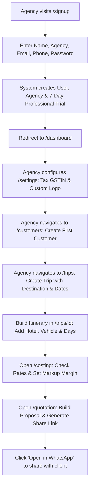
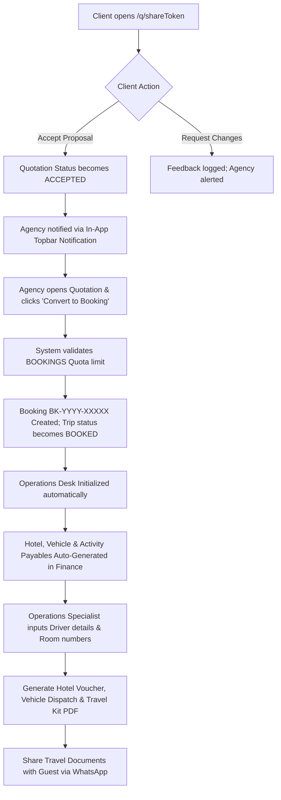
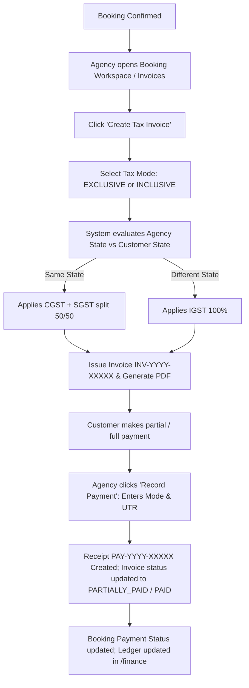
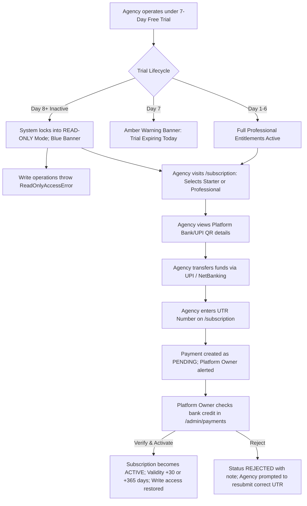

# Your Travel Desk — Complete Product Documentation Discovery & Planning Audit

**Document Version:** 1.0 (Audited Foundation)  
**Date:** October 16, 2026  
**Repository:** `C:\Users\hp\OneDrive\Desktop\Mohit\tripdesk`  
**Brand Identity:** **Your Travel Desk** (SaaS Agency Suite & Platform Administration)  
**Authoritative Continuity Context:** `TRIPDESK_MASTER_CONTEXT_FINAL_V3.md` (Sections 1–256)  
**Status:** READ-ONLY DISCOVERY AND DOCUMENTATION PLANNING COMPLETE

---

## Executive Summary & Product Overview

**Your Travel Desk** is a multi-tenant travel operations, quotation, costing, itinerary, and financial management software-as-a-service (SaaS) application built for boutique travel agencies, destination management companies (DMCs), and tour operators in India and internationally.

The application serves two distinct user classes:
1. **Agency Owners & Travel Specialists** (`AGENCY_OWNER` role):
   - Access the Agency Operations Suite (`/dashboard`, `/trips`, `/quotations`, `/bookings`, `/operations`, `/finance`, etc.)
   - Manage the complete lifecycle: Enquiry $\to$ Quotation $\to$ Booking $\to$ Operations $\to$ Invoicing $\to$ Post-Trip Closure.
2. **Platform Owner & SaaS Administrators** (`PLATFORM_OWNER` role, `agencyId: null`):
   - Access the SaaS Platform Console (`/admin`, `/admin/agencies`, `/admin/subscriptions`, `/admin/payments`, `/admin/plans`, etc.)
   - Supervise tenant onboarding, offline UTR payment approvals, plan limits, announcements, and global system health.

In addition, travelers and guests interact through **Stateless Public Portal Links**:
- Public Quotation Proposal (`/q/[shareToken]`)
- Live Traveler Trip Itinerary (`/trip/[secureToken]`)
- Digital Booking Confirmation Pass (`/b/[secureToken]`)

This discovery document records the verified truth of the application's features, database schemas, business logic, workflows, subscription restrictions, and communication capabilities as of commit `de87f7d`.

---

# SECTION 1 — Complete Feature Inventory

Each feature below has been code-inspected and verified against actual route handlers, UI components, backend services, and database schemas.

```
CLASSIFICATION LEGEND:
[AVAILABLE]             - Verified and available to all authenticated agency tiers
[PLAN-RESTRICTED]       - Available only on Professional plan or active 7-day Trial (locked on Starter)
[PROVIDER-DEPENDENT]    - Available via browser protocols (e.g. WhatsApp wa.me), no automated third-party API webhook
[PLATFORM-OWNER]        - Restricted to Platform Owner administrators (agencyId: null)
```

---

### Module 1: Authentication & Onboarding
* **1.1 Agency Owner Signup & Onboarding (`/signup`, `/app/onboarding`)** `[AVAILABLE]`
  * **Role:** Prospective Agency Owner
  * **Navigation:** `https://yourtraveldesk.in/signup` $\to$ `/login` $\to$ `/dashboard`
  * **Purpose:** Create agency tenant account, register agency profile, and automatically initialize 7-day Professional trial.
  * **Actions:** Enter full name, agency name, business email, phone, password; complete onboarding wizard.
  * **Prerequisites:** Unique email and agency name.
  * **Workflow:**
    1. User enters registration details.
    2. Supabase Auth creates account; TripDesk database creates `User` (`role: AGENCY_OWNER`) and `Agency` record.
    3. `onboardingService.provisionOnboardedAgencyOwner()` automatically initializes 7-day `TRIAL` subscription with Professional entitlements.
    4. Auto-redirects to `/dashboard`.
  * **Restrictions:** Duplicate email or agency name rejected.
  * **Evidence:** `src/actions/auth-actions.ts`, `src/lib/services/onboarding-service.ts`, `prisma/test-qa-05-signup.ts`.

* **1.2 Agency Login & Session Access (`/login`)** `[AVAILABLE]`
  * **Role:** Agency Owner, Staff, Platform Owner
  * **Navigation:** `/login`
  * **Purpose:** Authenticate and establish encrypted session cookie (`sb-access-token`, `sb-refresh-token`).
  * **Actions:** Enter email & password; click "Sign In"; toggle password visibility; click "Forgot Password".
  * **Prerequisites:** Registered account.
  * **Workflow:** Supabase credentials verified $\to$ database user resolved via `getRequestContext()` $\to$ routing gate: Platform Owner redirected to `/admin`, Agency redirected to `/dashboard`.
  * **Restrictions:** Locked if account suspended. Unverified email prompt is currently deferred (V3 Section 235).
  * **Evidence:** `src/app/login/page.tsx`, `src/actions/auth-actions.ts`, `src/lib/supabase/middleware.ts`.

* **1.3 Password Recovery (`/forgot-password`, `/reset-password`)** `[AVAILABLE]`
  * **Role:** All users
  * **Navigation:** `/forgot-password` $\to$ Email OTP $\to$ `/reset-password`
  * **Purpose:** Self-service password recovery via 8-digit OTP or secure recovery link.
  * **Actions:** Request OTP $\to$ enter 8-digit code $\to$ supply new password (min 8 chars) $\to$ submit.
  * **Restrictions:** Rate limited; OTP valid for 15 minutes; 60s resend cooldown.
  * **Evidence:** `src/app/forgot-password/page.tsx`, `src/app/reset-password/page.tsx`, `prisma/test-qa-22-password-recovery-otp.ts`.

---

### Module 2: Dashboard & Global Navigation
* **2.1 Agency Executive Dashboard (`/dashboard`)** `[AVAILABLE]`
  * **Role:** Agency Owner
  * **Navigation:** Sidebar $\to$ Main $\to$ Dashboard
  * **Purpose:** Central command center providing real-time operational KPI telemetry, conversion metrics, revenue charts, upcoming departures, and quick-action shortcuts.
  * **Actions:** View summary metrics, filter date ranges (7d, 30d, 90d, 12M, YTD), click quick action shortcuts (New Enquiry, New Trip, New Quotation, New Customer), view recent activity timeline.
  * **Prerequisites:** Active agency session.
  * **Telemetry Cards:** Total Active Trips, Quotations Won/Lost, Gross Pipeline Value, Payments Collected, Outstanding Balances, Live Operational Readiness gauge.
  * **Evidence:** `src/app/(dashboard)/dashboard/page.tsx`, `src/lib/services/dashboard-service.ts`.

* **2.2 Global Search (`Ctrl+K` / Topbar Search)** `[AVAILABLE]`
  * **Role:** Agency Owner
  * **Navigation:** Topbar Search Bar or keyboard shortcut `Cmd/Ctrl + K`
  * **Purpose:** High-speed lookup across all agency records (Customers, Trips, Quotations, Bookings, Destinations, Hotels, Invoices).
  * **Actions:** Type search query $\to$ view categorized preview results $\to$ navigate instantly.
  * **Evidence:** `src/components/shared/global-search.tsx`, `src/app/api/dashboard/summary/route.ts`.

* **2.3 Agency Lifecycle Banner** `[AVAILABLE]`
  * **Role:** Agency Owner
  * **Navigation:** Persistent sticky topbar banner (rendered across all agency pages)
  * **Purpose:** Proactively alert agency operators about account health: Trial countdown, Read-Only expiration mode, or Account Suspension.
  * **Banners:**
    1. *Account Suspended*: Red warning banner with direct "Contact Your Travel Desk Support" button.
    2. *Read-Only Mode*: Blue locked banner when subscription/trial has lapsed; write operations disabled; direct "Renew Subscription" button.
    3. *Trial Expiring Today/Tomorrow*: Amber warning banner indicating days remaining and "View Plans" upgrade button.
  * **Evidence:** `src/components/layout/agency-lifecycle-banner.tsx`.

---

### Module 3: Customer Relationship Management (CRM)
* **3.1 Customer Directory (`/customers`)** `[AVAILABLE]`
  * **Role:** Agency Owner
  * **Navigation:** Sidebar $\to$ Travel Management $\to$ Customers
  * **Purpose:** Unified database of corporate and retail travelers, booking history, lifetime financial spend, and communication preferences.
  * **Actions:** Search customers, filter by status/city, create new customer, edit customer profile, view customer dossier, launch direct WhatsApp chat.
  * **Inputs:** Full Name, Phone (mandatory), Email, City, State, Country, Address, Postal Code, GSTIN (optional corporate tax ID).
  * **Validations:** Duplicate phone & email check (`/api/customers/check-duplicate`).
  * **Evidence:** `src/app/(dashboard)/customers/page.tsx`, `src/lib/services/customer-service.ts`.

* **3.2 Customer Detail Dossier (`/customers/[id]`)** `[AVAILABLE]`
  * **Role:** Agency Owner
  * **Navigation:** Click customer row in `/customers`
  * **Purpose:** 360-degree customer profile displaying lifetime value, active trips, accepted quotations, payment receipts, co-travelers, and direct messaging history.
  * **Actions:** Edit details, add co-travelers, view trip history, open WhatsApp chat modal, view payment ledger.
  * **Evidence:** `src/app/(dashboard)/customers/[id]/page.tsx`, `src/lib/services/traveler-service.ts`.

* **3.3 Enquiries Desk (`/enquiries`)** `[AVAILABLE]`
  * **Role:** Agency Owner
  * **Navigation:** Sidebar $\to$ Travel Management $\to$ Enquiries
  * **Purpose:** Manage inbound sales leads, track enquiry pipeline stages, assign destinations, log customer requirements, and convert won leads directly into Trips.
  * **Actions:** Filter by stage (`NEW`, `CONTACTED`, `REQUIREMENT_GATHERING`, `PROPOSAL_SENT`, `NEGOTIATION`, `CONVERTED`, `LOST`), create enquiry, edit details, record timeline notes, schedule follow-up tasks, mark lost with reason, convert to Trip.
  * **Inputs:** Customer, Destination, Estimated Travel Dates, Pax Count (Adults, Children), Budget, Travel Style, Source Channel (WhatsApp, Referral, Social, Direct).
  * **Workflow:** Move enquiry across stages $\to$ click "Convert to Trip" $\to$ system automatically creates a linked Trip and marks Enquiry `CONVERTED`.
  * **Evidence:** `src/app/(dashboard)/enquiries/page.tsx`, `src/lib/services/enquiry-service.ts`.

* **3.4 Follow-ups Calendar & Tasks (`/follow-ups`)** `[AVAILABLE]`
  * **Role:** Agency Owner
  * **Navigation:** Sidebar $\to$ Finance & Retention $\to$ Follow-ups
  * **Purpose:** Scheduled task manager ensuring no quotation, lead, or payment reminder falls through the cracks.
  * **Actions:** View calendar & agenda, filter by task type (`CALL`, `WHATSAPP`, `EMAIL`, `MEETING`), mark completed, reschedule date/time, add notes.
  * **Evidence:** `src/app/(dashboard)/follow-ups/page.tsx`, `src/lib/services/follow-up-service.ts`.

---

### Module 4: Resource Catalog & Master Inventory
* **4.1 Destinations Master (`/destinations`)** `[AVAILABLE]`
  * **Role:** Agency Owner
  * **Navigation:** Sidebar $\to$ Resources $\to$ Destinations
  * **Purpose:** Maintain destination database (Country, State, City/Area, Descriptions) used across itinerary builders, costing sheets, and quotations.
  * **Actions:** Search destinations, filter by active/inactive status, create destination, edit details, toggle active state, delete destination.
  * **Evidence:** `src/app/(dashboard)/destinations/page.tsx`, `src/lib/services/destination-service.ts`.

* **4.2 Hotels Directory (`/hotels`)** `[AVAILABLE]`
  * **Role:** Agency Owner
  * **Navigation:** Sidebar $\to$ Resources $\to$ Hotels
  * **Purpose:** Catalog of hotel properties, star ratings, room types, meal plans, amenities, and vendor contacts.
  * **Actions:** Search, filter by destination/star rating, create hotel, edit property, import from Excel/CSV (`/api/hotels/import`), download sample Excel template (`/api/hotels/sample`), link to supplier.
  * **Evidence:** `src/app/(dashboard)/hotels/page.tsx`, `src/lib/services/hotel-service.ts`.

* **4.3 Rate Sheets & Contract Tariffs (`/rate-sheets`)** `[AVAILABLE]`
  * **Role:** Agency Owner
  * **Navigation:** Sidebar $\to$ Resources $\to$ Rate Sheets
  * **Purpose:** Store seasonal supplier contract rates (Off-Season, Peak, Holiday) by room type and meal plan (EP, CP, MAP, AP) with extra bed/child rates.
  * **Actions:** Search rate sheets, create seasonal tariff, import rate sheets via Excel, auto-lookup rates in quotation costing workspace (`/api/rate-sheets/lookup`).
  * **Evidence:** `src/app/(dashboard)/rate-sheets/page.tsx`, `src/lib/services/rate-sheet-service.ts`.

* **4.4 Fleet & Vehicles Master (`/vehicles`)** `[AVAILABLE]`
  * **Role:** Agency Owner
  * **Navigation:** Sidebar $\to$ Resources $\to$ Vehicles
  * **Purpose:** Vehicle types (Sedan, SUV, Luxury, Tempo Traveller), passenger capacities, luggage allowances, and base rates.
  * **Actions:** Add vehicle model, set capacity, assign base per-km/day tariff, edit details.
  * **Evidence:** `src/app/(dashboard)/vehicles/page.tsx`, `src/lib/services/vehicle-service.ts`.

* **4.5 Activities & Sightseeing Master (`/activities`)** `[AVAILABLE]`
  * **Role:** Agency Owner
  * **Navigation:** Sidebar $\to$ Resources $\to$ Activities
  * **Purpose:** Curated catalog of tours, excursions, entrance tickets, and experiences with duration, destination, and default retail/net costs.
  * **Actions:** Create activity, assign destination, set duration and pricing, edit details.
  * **Evidence:** `src/app/(dashboard)/activities/page.tsx`, `src/lib/services/activity-service.ts`.

* **4.6 Suppliers & Vendor Ledger (`/suppliers`)** `[AVAILABLE]`
  * **Role:** Agency Owner
  * **Navigation:** Direct URL `/suppliers` (linked from Hotels, Operations, and Finance)
  * **Purpose:** Manage hoteliers, transporters, DMCs, and excursion providers, their payout bank/UPI details, GSTIN, and payables history.
  * **Actions:** Search suppliers, create supplier, edit details, record bank/UPI details, check duplicate supplier code/phone.
  * **Evidence:** `src/app/(dashboard)/suppliers/page.tsx`, `src/lib/services/supplier-service.ts`.

---

### Module 5: Trips & Itinerary Workspace
* **5.1 Trip Workspace (`/trips`)** `[AVAILABLE]`
  * **Role:** Agency Owner
  * **Navigation:** Sidebar $\to$ Travel Management $\to$ Trips
  * **Purpose:** Master repository of all travel files across all stages (`DRAFT`, `PLANNING`, `QUOTED`, `BOOKED`, `ONGOING`, `COMPLETED`, `CANCELLED`).
  * **Actions:** Search trips, filter by status, view departure dates, create new trip.
  * **Plan Quota:** Starter plan capped at 20 trips per 30-day billing cycle; Professional plan is unlimited.
  * **Evidence:** `src/app/(dashboard)/trips/page.tsx`, `src/lib/services/trip-service.ts`, `src/lib/services/entitlement-service.ts`.

* **5.2 Day-by-Day Itinerary Builder (`/trips/[id]`)** `[AVAILABLE]`
  * **Role:** Agency Owner
  * **Navigation:** Click trip row in `/trips`
  * **Purpose:** Intuitive day-by-day planner assembling destination timeline, hotel stays, vehicle allocations, and sightseeing activities into a cohesive travel program.
  * **Actions:** Add days, assign destination, add day title & description, attach hotel stay, attach vehicle transit, add activity items, add travelers.
  * **Evidence:** `src/app/(dashboard)/trips/[id]/page.tsx`, `src/lib/services/itinerary-service.ts`.

* **5.3 Trip Costing Sheet (`/trips/[id]/costing`)** `[AVAILABLE]`
  * **Role:** Agency Owner
  * **Navigation:** Trip Details $\to$ Costing Tab
  * **Purpose:** Confidential internal costing engine calculating net supplier expenses, applied markups (percentage or fixed flat amount), GST/tax calculations, and total retail selling price.
  * **Actions:** Add cost components (Accommodations, Transport, Activities, Miscellaneous), select rate sheets or enter net rates, adjust markup percentage, view net vs gross profit margin.
  * **Evidence:** `src/app/(dashboard)/trips/[id]/costing/page.tsx`, `src/lib/services/trip-costing-service.ts`.

---

### Module 6: Quotations, Versioning & Client Proposals
* **6.1 Quotation Workspace (`/trips/[id]/quotation`)** `[AVAILABLE]`
  * **Role:** Agency Owner
  * **Navigation:** Trip Details $\to$ Quotation Tab (or `/quotations`)
  * **Purpose:** Compile professional, branded client proposals from the itinerary and costing sheet, with tiered options, inclusions/exclusions, and payment milestone terms.
  * **Actions:** Create quotation, edit proposal items, set package tier (Standard, Deluxe, Luxury), define payment milestones, set validity date, publish proposal, copy share link, open WhatsApp share modal.
  * **Plan Quota:** Starter plan capped at 20 quotations per billing cycle; Professional plan is unlimited.
  * **Evidence:** `src/app/(dashboard)/trips/[id]/quotation/page.tsx`, `src/lib/services/quotation-service.ts`.

* **6.2 Quotation Versioning & Branching** `[AVAILABLE]`
  * **Role:** Agency Owner
  * **Navigation:** Quotation Workspace $\to$ Version History
  * **Purpose:** Duplicate and branch quotation proposals into v1, v2, v3 when clients request itinerary or pricing revisions without overwriting historical quotes.
  * **Actions:** Click "Create New Version" $\to$ auto-clones proposal items, costing, and terms with incremented version number $\to$ edit independently.
  * **Evidence:** `src/lib/services/quotation-service.ts` (`createQuotationVersion`).

* **6.3 Branded Quotation PDF Generation** `[AVAILABLE]`
  * **Role:** Agency Owner, Customer
  * **Navigation:** Quotation Workspace $\to$ "Download PDF" (`/api/quotations/[id]/pdf`)
  * **Purpose:** High-resolution PDF proposal featuring agency branding, custom logo, day-by-day itinerary, hotel details, inclusions, exclusions, payment milestones, and terms.
  * **Evidence:** `src/lib/services/quotation-pdf-service.ts`, `src/app/api/quotations/[id]/pdf/route.ts`.

* **6.4 Public Client Proposal Portal (`/q/[shareToken]`)** `[AVAILABLE]`
  * **Role:** Traveler / End-Client (Passwordless Guest Access)
  * **Navigation:** Direct URL generated by agency (e.g. `https://yourtraveldesk.in/q/psl_...`)
  * **Purpose:** Interactive, mobile-responsive web proposal where clients can explore day-by-day photos, hotel choices, pricing breakdown, and take action.
  * **Actions:**
    1. *Accept Proposal*: Sets quotation status to `ACCEPTED` and notifies agency owner.
    2. *Request Changes*: Submits client feedback note and notifies agency owner.
    3. *Download PDF*: Downloads branded PDF.
  * **Critical Distinction:** Accepting a quotation does **not** automatically confirm a booking in the database. The agency operator must deliberately click "Convert to Booking".
  * **Evidence:** `src/app/q/[shareToken]/page.tsx`, `src/lib/services/quotation-service.ts`.

* **6.5 WhatsApp Quotation Sharing** `[PROVIDER-DEPENDENT]`
  * **Role:** Agency Owner
  * **Navigation:** Quotation Preview $\to$ "Open in WhatsApp"
  * **Purpose:** One-click dispatch of quotation proposal link and personalized greeting to traveler's WhatsApp.
  * **Mechanism:** Uses official Click-to-Chat protocol (`https://wa.me/91XXXXXXXXXX?text=...`). Validates 10-digit Indian mobile and international E.164 formats. Opens browser tab. Logs dispatch note with status `PENDING` and mode `CLICK_TO_CHAT`.
  * **Evidence:** `src/lib/communication/whatsapp/click-to-chat.ts`, `src/components/quotation/quotation-share-modal.tsx`.

---

### Module 7: Bookings & Operations Management
* **7.1 Booking Management (`/bookings`, `/bookings/[id]`)** `[AVAILABLE]`
  * **Role:** Agency Owner
  * **Navigation:** Sidebar $\to$ Travel Management $\to$ Bookings
  * **Purpose:** Authoritative file for confirmed client travel files, tracking payment fulfillment, issuing traveler vouchers, generating tax invoices, and linking to operations.
  * **Actions:** Create direct booking or convert from quotation; record customer payments; issue tax invoices; generate travel vouchers; update booking status (`CONFIRMED`, `IN_PROGRESS`, `COMPLETED`, `CANCELLED`).
  * **Plan Quota:** Starter plan capped at 20 bookings per billing cycle; Professional plan is unlimited.
  * **Evidence:** `src/app/(dashboard)/bookings/page.tsx`, `src/app/(dashboard)/bookings/[id]/page.tsx`, `src/lib/services/booking-service.ts`.

* **7.2 Operations Hub & Live Desk (`/operations`, `/operations/[tripId]`)** `[AVAILABLE]`
  * **Role:** Agency Owner / Operations Specialist
  * **Navigation:** Sidebar $\to$ Travel Management $\to$ Operations [Live Badge]
  * **Purpose:** Real-time day-to-day ground operations center managing supplier confirmations, driver allocations, operational issues, readiness checklists, and post-trip reconciliation.
  * **Operational Cards:**
    1. *Accommodations Desk*: Enter hotel confirmation numbers, room types, meal plans, check-in dates, supplier selection; generate Hotel Voucher.
    2. *Fleet & Transit Desk*: Assign driver name, driver mobile phone, vehicle registration plate, pickup time/location; generate Vehicle Dispatch Voucher.
    3. *Activities Desk*: Record activity booking reference numbers, timing, and local tour guide contacts; generate Activity Voucher.
    4. *Travel Kit Generation*: Compile comprehensive multi-service traveler kit PDF (`TRAVEL_KIT_VOUCHER`).
    5. *Incident & Issue Tracker*: Log operational hurdles (Hotel issue, Vehicle breakdown, Flight delay, Guest complaint) with severity (`LOW`, `MEDIUM`, `HIGH`, `CRITICAL`) and resolution status (`OPEN`, `IN_PROGRESS`, `RESOLVED`, `ESCALATED`).
    6. *Post-Trip Closure & Reconciliation*: Audit actual expenses against estimated costing, log guest satisfaction rating (1–5), and lock file to `FINALIZED`.
  * **Evidence:** `src/app/(dashboard)/operations/page.tsx`, `src/app/(dashboard)/operations/[tripId]/page.tsx`, `src/lib/services/operations-service.ts`.

* **7.3 Context-Locked Supplier Disbursement** `[AVAILABLE]`
  * **Role:** Agency Owner
  * **Navigation:** Operations card $\to$ "Record Payment"
  * **Purpose:** Securely log supplier payables disbursement (e.g. advance to hotel or driver payout) locked strictly to the specific payable card, preventing accidental misallocation.
  * **Evidence:** `src/components/finance/record-supplier-payment-dialog.tsx`, V3 Section 252.

* **7.4 Travel Documents Hub (`/documents`)** `[AVAILABLE]`
  * **Role:** Agency Owner
  * **Navigation:** Sidebar $\to$ Travel Management $\to$ Documents
  * **Purpose:** Centralized repository to issue, view, download, revoke, and re-share all passenger travel vouchers across all active bookings.
  * **Actions:** Filter by document type, issue voucher, download PDF, share on WhatsApp with customer portal link, revoke document.
  * **Evidence:** `src/app/(dashboard)/documents/page.tsx`, `src/lib/services/travel-document-service.ts`, `src/lib/services/document-pdf-service.ts`.

---

### Module 8: Finance, Taxes & Invoicing
* **8.1 Tax Invoicing & Sequence (`/invoices`, `/invoices/[id]`)** `[AVAILABLE]`
  * **Role:** Agency Owner
  * **Navigation:** Direct URL `/invoices` (and linked from `/bookings/[id]` & `/finance`)
  * **Purpose:** Issue compliant GST tax invoices, record line items, apply discounts, calculate intra-state (CGST + SGST) vs inter-state (IGST) taxes, and generate branded invoice PDFs.
  * **Actions:** Create invoice from booking, issue draft invoice, download PDF (`/api/invoices/[id]/pdf`), record invoice payment, void payment, cancel invoice, issue replacement invoice.
  * **Sequence:** Agency-scoped sequential numbering (`INV-YYYY-XXXXX`).
  * **Evidence:** `src/app/(dashboard)/invoices/page.tsx`, `src/lib/services/invoice-service.ts`, `src/lib/services/invoice-pdf-service.ts`.

* **8.2 Finance Dashboard & Ledger (`/finance`)** `[AVAILABLE]`
  * **Role:** Agency Owner
  * **Navigation:** Sidebar $\to$ Finance & Retention $\to$ Finance
  * **Purpose:** Financial cockpit providing executive overview of customer receivables, supplier payables, gross revenue, net payouts, and profit margins.
  * **Tabs:**
    1. *Summary*: Revenue, Collected, Receivables, Payables, Net Margin cards.
    2. *Customer Receivables*: Overdue balances, upcoming milestone dues.
    3. *Supplier Payables*: Outstanding hotel/vehicle disbursement schedule.
    4. *Transactions*: Unified cashbook of all customer receipts and vendor payments.
    5. *Export*: Download complete financial ledger to Excel.
  * **Evidence:** `src/app/(dashboard)/finance/page.tsx`, `src/lib/services/finance-service.ts`.

* **8.3 Customer Payment Receipts (`/payments`)** `[AVAILABLE]`
  * **Role:** Agency Owner
  * **Navigation:** Sidebar $\to$ Finance & Retention $\to$ Payments
  * **Purpose:** Record and track customer payment receipts (Advance, Milestone, Final Balance) across bookings.
  * **Actions:** Record payment, select method (UPI, NEFT/IMPS, Card, Cash), enter transaction reference, download branded receipt PDF.
  * **Evidence:** `src/app/(dashboard)/payments/page.tsx`, `src/lib/services/payment-service.ts`.

* **8.4 Tax Configuration & GST Profile (`/settings` $\to$ Tax Tab)** `[AVAILABLE]`
  * **Role:** Agency Owner
  * **Navigation:** Settings $\to$ Tax Profile Tab
  * **Purpose:** Configure agency tax status (GST registered / unregistered), legal name, GSTIN, 2-digit state code, default tax mode (`EXCLUSIVE` vs `INCLUSIVE`), default rate (0%, 5%, 12%, 18%, 28%), and default GST treatment.
  * **Evidence:** `src/app/(dashboard)/settings/page.tsx`, `src/lib/services/tax-profile-service.ts`.

---

### Module 9: Retention, Reviews & Intelligence
* **9.1 Feedback & Reviews Desk (`/feedback`)** `[PLAN-RESTRICTED]`
  * **Role:** Agency Owner
  * **Navigation:** Sidebar $\to$ Finance & Retention $\to$ Feedback & Reviews
  * **Entitlement Key:** `FEEDBACK_REVIEWS` (Enabled on Professional & Trial; locked on Starter).
  * **Purpose:** Collect and monitor post-trip customer satisfaction ratings (1–5 stars) and testimonials submitted via the customer portal.
  * **Actions:** View average rating score, read reviews, filter by rating/sentiment, mark testimonials for marketing display.
  * **Evidence:** `src/app/(dashboard)/feedback/page.tsx`, `src/lib/services/feedback-service.ts`.

* **9.2 Customer Insights & Analytics (`/customer-insights`)** `[PLAN-RESTRICTED]`
  * **Role:** Agency Owner
  * **Navigation:** Sidebar $\to$ Finance & Retention $\to$ Customer Insights
  * **Entitlement Key:** `CUSTOMER_INSIGHTS` (Enabled on Professional & Trial; locked on Starter).
  * **Purpose:** Intelligent segmentation of agency customer base: VIP High-Value travelers, Repeat Travelers, Dormant Clients, and Destination Affinity trends.
  * **Evidence:** `src/app/(dashboard)/customer-insights/page.tsx`, `src/lib/services/customer-insights-service.ts`.

* **9.3 Executive Reports & Analytics (`/reports`)** `[PLAN-RESTRICTED]`
  * **Role:** Agency Owner
  * **Navigation:** Sidebar $\to$ Finance & Retention $\to$ Reports & Analytics
  * **Entitlement Key:** `REPORTS_ANALYTICS` (Enabled on Professional & Trial; locked on Starter).
  * **Purpose:** Multi-dimensional business reporting across Sales Conversion, Destination Popularity, Supplier Performance, and Profitability.
  * **Actions:** Filter date ranges, view visual trend graphs, export reports to Excel and PDF.
  * **Evidence:** `src/app/(dashboard)/reports/page.tsx`, `src/lib/services/reporting-service.ts`.

* **9.4 Agency Referral System (`/referrals`)** `[AVAILABLE]`
  * **Role:** Agency Owner
  * **Navigation:** Direct URL `/referrals`
  * **Purpose:** Track client-referred bookings, referral codes, referrer rewards, and conversion status (`PENDING`, `CONVERTED`, `REWARDED`).
  * **Evidence:** `src/app/(dashboard)/referrals/page.tsx`, `src/lib/services/referral-service.ts`.

---

### Module 10: Communications & Agency Support Desk
* **10.1 Communications Hub (`/communications`)** `[PROVIDER-DEPENDENT]`
  * **Role:** Agency Owner
  * **Navigation:** Sidebar $\to$ Finance & Retention $\to$ Communications
  * **Purpose:** Log and view all outgoing operational messages and reminders sent to travelers and suppliers.
  * **Actions:** Filter logs, click "Open in WhatsApp" to compose custom message to customer phone, trigger automated reminder sweep.
  * **Evidence:** `src/app/(dashboard)/communications/page.tsx`, `src/lib/services/communication-service.ts`.

* **10.2 Agency Support Chat Desk (`/support`)** `[AVAILABLE]`
  * **Role:** Agency Owner
  * **Navigation:** Sidebar $\to$ Settings $\to$ Support Chat
  * **Purpose:** In-app real-time messaging channel connecting Agency Owners directly with the Your Travel Desk platform administration team for technical assistance and billing questions.
  * **Actions:** Send messages, view unread counter badge, receive answers from Platform Owner.
  * **Evidence:** `src/app/(dashboard)/support/page.tsx`, `src/lib/services/platform-chat-service.ts`.

---

### Module 11: Customer Portal & Public Guest Access
* **11.1 Guest Travel Portal (`/customer/trips/[tripId]`)** `[AVAILABLE]`
  * **Role:** Traveler / End-Client
  * **Navigation:** Accessed via secure token link or `/customer/trips/[tripId]`
  * **Purpose:** Mobile-optimized, passwordless traveler hub displaying day-by-day itinerary, hotel details, live flight/transit timings, and agency emergency contacts.
  * **Whitelisted Views:** Excludes all internal agency markups, supplier costs, and confidential operator notes.
  * **Evidence:** `src/app/customer/trips/[tripId]/page.tsx`, `src/lib/services/customer-portal-service.ts`.

* **11.2 Customer Documents Download (`/customer/trips/[tripId]/documents`)** `[AVAILABLE]`
  * **Role:** Traveler / End-Client
  * **Purpose:** Direct PDF download of traveler hotel vouchers, driver dispatch passes, activity tickets, and itinerary PDFs.
  * **Security Guard:** `TravelDocumentType.SUPPLIER_VOUCHER` is strictly excluded to prevent supplier rate leaks.
  * **Evidence:** `src/app/customer/trips/[tripId]/documents/page.tsx`, V3 Section 254.

* **11.3 Public Booking Pass (`/b/[secureToken]`)** `[AVAILABLE]`
  * **Role:** Traveler / End-Client
  * **Navigation:** Direct link `/b/psl_...`
  * **Purpose:** Lightweight digital booking pass showing booking reference, travel dates, passenger list, balance status, and emergency contacts.
  * **Evidence:** `src/app/b/[secureToken]/page.tsx`, `src/lib/services/booking-public-service.ts`.

* **11.4 Public Itinerary Overview (`/trip/[secureToken]`)** `[AVAILABLE]`
  * **Role:** Traveler / End-Client
  * **Navigation:** Direct link `/trip/psl_...`
  * **Purpose:** Interactive web presentation of the trip itinerary with photos, day descriptions, and destination guides.
  * **Evidence:** `src/app/trip/[secureToken]/page.tsx`, `src/lib/services/trip-public-service.ts`.

---

### Module 12: Agency Settings & Custom Branding
* **12.1 Agency Profile & Brand Setup (`/settings`)** `[AVAILABLE]`
  * **Role:** Agency Owner
  * **Navigation:** Sidebar $\to$ Settings $\to$ Agency Settings
  * **Purpose:** Maintain business contact details, email sender profile, and public contact information.
  * **Evidence:** `src/app/(dashboard)/settings/page.tsx`.

* **12.2 Custom Logo Upload (`/settings` $\to$ Branding Tab)** `[PLAN-RESTRICTED]`
  * **Role:** Agency Owner
  * **Entitlement Key:** `CUSTOM_AGENCY_LOGO` (Enabled on Professional & Trial; locked on Starter).
  * **Purpose:** Upload agency brand logo (PNG, JPEG, WebP, max 2MB) which automatically stamps onto Quotation PDFs, Invoice PDFs, Vouchers, and Public Proposals.
  * **Evidence:** `src/app/(dashboard)/settings/page.tsx`, `src/lib/services/agency-logo-service.ts`.

---

### Module 13: Subscription & Billing Management
* **13.1 Subscription Dashboard (`/subscription`)** `[AVAILABLE]`
  * **Role:** Agency Owner
  * **Navigation:** Sidebar $\to$ Settings $\to$ Subscription
  * **Purpose:** View current plan tier, trial days remaining, monthly/annual quota usage telemetry (Trips, Quotes, Bookings), available upgrade plans, and offline billing details.
  * **Actions:** View available plans, select Monthly/Annual billing, view Platform UPI/Bank account details, submit payment request with UTR number, view payment history and approval status.
  * **Evidence:** `src/app/(dashboard)/subscription/page.tsx`, `src/lib/services/subscription-service.ts`.

* **13.2 Offline UTR Payment Submission** `[AVAILABLE]`
  * **Role:** Agency Owner
  * **Purpose:** Agencies pay via direct UPI QR code or NEFT/IMPS bank transfer, then input the 12-digit UTR transaction reference number and optional payment screenshot note.
  * **System Action:** Creates `SubscriptionPayment` with status `PENDING`, notifies Platform Owner for verification.
  * **Evidence:** `src/lib/services/subscription-service.ts` (`createPaymentRequest`).

---

### Module 14: Platform Owner Administration
* **14.1 Admin Command Dashboard (`/admin`)** `[PLATFORM-OWNER]`
  * **Role:** Platform Owner (`agencyId: null`)
  * **Navigation:** `/admin`
  * **Purpose:** SaaS-wide executive dashboard displaying Total Registered Agencies, Active Subscriptions, Monthly Recurring Revenue (MRR), Active 7-Day Trials, and Pending Payment Approvals.
  * **Evidence:** `src/app/admin/page.tsx`, `src/lib/services/admin-service.ts`.

* **14.2 Agency Directory Management (`/admin/agencies`)** `[PLATFORM-OWNER]`
  * **Role:** Platform Owner
  * **Purpose:** View all tenant agencies, owner contact info, current subscription status, registration dates, and manually toggle suspension (`ACTIVE`, `SUSPENDED`).
  * **Evidence:** `src/app/admin/agencies/page.tsx`.

* **14.3 Subscription Approvals & Payment Desk (`/admin/payments`, `/admin/subscriptions`)** `[PLATFORM-OWNER]`
  * **Role:** Platform Owner
  * **Purpose:** Review offline subscription payments submitted by agencies. Verify UTR credit in platform bank account, click "Verify & Activate" to grant 30-day or 365-day access, or click "Reject" with reason.
  * **Evidence:** `src/app/admin/payments/page.tsx`, `src/app/admin/subscriptions/page.tsx`.

* **14.4 SaaS Pricing & Plan Catalog Manager (`/admin/plans`)** `[PLATFORM-OWNER]`
  * **Role:** Platform Owner
  * **Purpose:** Dynamically adjust public catalog prices (Starter ₹499/mo, Professional ₹999/mo), annual prices, descriptions, and feature lists without code deployments.
  * **Evidence:** `src/app/admin/plans/page.tsx`.

* **14.5 Platform Multi-Tenant Support Chat (`/admin/chat`)** `[PLATFORM-OWNER]`
  * **Role:** Platform Owner
  * **Purpose:** Unified inbox to read and respond to technical/billing inquiries from any registered agency owner in real time.
  * **Evidence:** `src/app/admin/chat/page.tsx`, `src/lib/services/platform-chat-service.ts`.

* **14.6 Platform Audit Logs (`/admin/audit-logs`)** `[PLATFORM-OWNER]`
  * **Role:** Platform Owner
  * **Purpose:** Immutable compliance security log recording all administrative actions (actor, action, entity, IP, timestamp).
  * **Evidence:** `src/app/admin/audit-logs/page.tsx`.

* **14.7 Platform Billing Settings (`/admin/settings`)** `[PLATFORM-OWNER]`
  * **Role:** Platform Owner
  * **Purpose:** Configure the platform's UPI ID, QR code URL, Bank Account Number, Bank Name, and IFSC code displayed to agencies on the subscription page.
  * **Evidence:** `src/app/admin/settings/page.tsx`.

---

# SECTION 2 — Navigation & Route Map

### 1. Agency Workspace Navigation Hierarchy
```
/dashboard                          - Agency Executive Dashboard
├── /enquiries                      - Enquiries Pipeline & Lead Stages
│   ├── /enquiries/new              - New Enquiry Form
│   └── /enquiries/[id]             - Enquiry Dossier & Conversion
├── /customers                      - Customer Directory
│   ├── /customers/new              - New Customer Form
│   └── /customers/[id]             - Customer Dossier & Ledger
├── /trips                          - Trip Master Ledger
│   ├── /trips/new                  - New Trip Wizard
│   └── /trips/[id]                 - Trip Day-by-Day Itinerary Builder
│       ├── /trips/[id]/costing     - Trip Costing Sheet
│       └── /trips/[id]/quotation   - Quotation Builder Workspace
│           └── /preview            - Quotation Live Preview
├── /quotations                     - Quotations Index Table
├── /bookings                       - Bookings Master Ledger
│   ├── /bookings/new               - Direct Booking Form
│   └── /bookings/[id]              - Booking Workspace (Vouchers, Invoices, Payments)
├── /documents                      - Travel Documents Hub
├── /operations                     - Live Operations Dashboard
│   └── /operations/[tripId]        - Ground Operations Desk & Dispatch
├── /destinations                   - Destination Master
├── /hotels                         - Hotel Directory & Import
│   ├── /hotels/new                 - Add Hotel
│   └── /hotels/[id]                - Edit Hotel
├── /vehicles                       - Fleet & Vehicle Master
├── /activities                     - Excursions & Activities Master
├── /rate-sheets                    - Seasonal Hotel Rate Sheets
├── /suppliers                      - Supplier & Vendor Master
├── /invoices                       - Tax Invoice Index
│   └── /invoices/[id]              - Invoice Workspace & PDF
├── /finance                        - Finance Dashboard, Receivables & Payables
├── /payments                       - Customer Payment Receipts
├── /follow-ups                     - Scheduled Follow-ups Calendar
├── /feedback                       - Client Reviews & Ratings (Plan-Gated)
├── /customer-insights              - Customer Segmentation (Plan-Gated)
├── /reports                        - Analytics & Reporting (Plan-Gated)
├── /referrals                      - Referral Reward Tracking
├── /communications                 - Communication Logs & Dispatch
├── /settings                       - Agency Settings (Branding, Tax, Comms)
├── /subscription                   - Subscription, Quotas & UTR Payments
└── /support                        - Agency Two-Way Support Chat
```

### 2. Public & Guest Portal Routes
```
/q/[shareToken]                     - Public Quotation Proposal (Accept / Request Changes / PDF)
/trip/[secureToken]                 - Public Guest Trip Portal (Itinerary, Countdown, Details)
/b/[secureToken]                    - Digital Booking Confirmation Pass
/customer/login                     - Stateless Guest Notice (Directs to secure token links)
/customer/trips/[tripId]            - Customer Trip Overview
/customer/trips/[tripId]/documents  - Customer Traveler Vouchers (Supplier Vouchers excluded)
/customer/trips/[tripId]/feedback   - Customer Review Submission
/customer/trips/[tripId]/payments   - Customer Payment Receipts
```

### 3. Platform Administration Routes (`PLATFORM_OWNER` Only)
```
/admin                              - SaaS Executive Command Dashboard
/admin/agencies                     - Multi-Tenant Agency Directory & Suspension
/admin/subscriptions                - Subscription Status & Extensions
/admin/payments                     - UTR Payment Verification Desk
/admin/plans                        - SaaS Plan Pricing & Catalog Editor
/admin/analytics                    - Platform Growth & Usage Analytics
/admin/chat                         - Multi-Agency Support Console
/admin/announcements                - Broadcast Announcements
/admin/audit-logs                   - Security & Administrative Audit Trail
/admin/settings                     - Platform Bank & UPI Billing Settings
```

---

# SECTION 3 — Verified End-to-End Business Workflows

### Workflow 1: New Agency Onboarding to First Proposal


### Workflow 2: Quotation Approval to Booking & Operations Execution


### Workflow 3: Invoicing, Taxation & Payment Fulfillment


### Workflow 4: Subscription Trial, Upgrade & UTR Approval


---

# SECTION 4 — Subscription, Pricing & Entitlement Matrix

Verified against `prisma/seed.ts`, `src/lib/services/entitlement-service.ts`, and V3 Section 236:

| Attribute | 7-Day Free Trial | Starter Plan | Professional Plan |
| :--- | :--- | :--- | :--- |
| **Monthly Price** | Free (₹0) | **₹499 / month** | **₹999 / month** |
| **Annual Price** | N/A | **₹4,999 / year** (Save ~17%) | **₹9,999 / year** (Save ~17%) |
| **Duration / Billing Cycle** | 7 Days (one-time) | 30 Days recurring | 30 Days recurring |
| **Trips Quota** | Unlimited (Pro tier) | **20 Trips** / cycle | **Unlimited** |
| **Quotations Quota** | Unlimited (Pro tier) | **20 Quotations** / cycle | **Unlimited** |
| **Bookings Quota** | Unlimited (Pro tier) | **20 Bookings** / cycle | **Unlimited** |
| **Customers Quota** | Unlimited | Unlimited | Unlimited |
| **Custom Agency Logo** | ✅ Allowed | ❌ **Locked** (Upgrade required) | ✅ **Allowed** |
| **Feedback & Reviews** | ✅ Allowed | ❌ **Locked** (Upgrade required) | ✅ **Allowed** |
| **Customer Insights** | ✅ Allowed | ❌ **Locked** (Upgrade required) | ✅ **Allowed** |
| **Reports & Analytics** | ✅ Allowed | ❌ **Locked** (Upgrade required) | ✅ **Allowed** |
| **WhatsApp Click-to-Chat**| ✅ Allowed | ✅ Allowed | ✅ Allowed |
| **Operations Desk & Vouchers**| ✅ Allowed | ✅ Allowed | ✅ Allowed |
| **Invoicing & GST Split** | ✅ Allowed | ✅ Allowed | ✅ Allowed |
| **Expired State Behavior** | Enters **Read-Only Mode** | Enters **Read-Only Mode** | Enters **Read-Only Mode** |

*Note: During the 7-day free trial, agencies receive full Professional entitlements to evaluate the complete operating suite.*

---

# SECTION 5 — Communication Architecture Truths

To prevent false claims in user documentation, the following technical facts are confirmed:

1. **WhatsApp Delivery is Operator-Launched via Click-to-Chat:**
   - The application does **not** connect to the Meta WhatsApp Cloud API.
   - When an operator clicks "Open in WhatsApp", the app validates the phone number (normalizing 10-digit Indian numbers to E.164 `91XXXXXXXXXX`) and generates a safe `https://wa.me/<phone>?text=<encoded_message>` URL.
   - It opens WhatsApp Web / App in a new browser tab. The operator reviews and presses send.
   - In-app notification logs record this with status `PENDING` and mode `CLICK_TO_CHAT`.
2. **Email Sending UI is Completely Removed:**
   - Per V3 Section 253, all email sending buttons and toggles were removed from compose surfaces (Quotations, Operations, Documents, Customers).
   - The only active emails sent by the system are **Supabase Transactional Auth emails** (signup confirmation, OTP password resets).
3. **Inbound Webhook Receiver is Disabled:**
   - Inbound webhook receiver `/api/webhooks/communication` returns HTTP 404 permanently. No third-party delivery status callbacks are processed.
4. **Customer Notifications are In-App & Stateless:**
   - Guests receive document and proposal links from the agency via WhatsApp or direct copy-paste.
   - Notification popovers inside the application alert agency operators in real time.

---

# SECTION 6 — Known Limitations & Discrepancies (Code vs. UI vs. V3)

| Item | Actual Code / Behavior | UI Presentation | V3 Continuity Note | Documentation Handling |
| :--- | :--- | :--- | :--- | :--- |
| **Product Brand Name** | Codebase directories say `tripdesk`; display title says "Your Travel Desk". | Sidebar & Topbar show "Your Travel Desk". | Preserved as "Your Travel Desk". | Documentation must **strictly** use **Your Travel Desk**. |
| **Accepted Quote $\to$ Booking** | Quotation acceptance updates status to `ACCEPTED` and notifies agency; does not auto-create booking. | Quote detail card shows "Accepted"; "Convert to Booking" button appears. | V3 Section 251/252 confirms decoupled booking creation. | Clearly explain that agency must click "Convert to Booking" to initialize operations and payables. |
| **Email Toggles in Settings** | Settings has `emailEnabled` toggle and `defaultSenderEmail`. | Shows toggle on Settings page. | V3 Section 253 removed email dispatch from operational compose views. | Clarify in Settings guide that email is reserved for system auth; WhatsApp is the primary client channel. |
| **Starter Plan Feature Locks** | Feature flags (`CUSTOM_AGENCY_LOGO`, `FEEDBACK_REVIEWS`, etc.) throw `FeatureNotAllowedError` if bypassed. | Sidebar shows lock icon on Starter plan. | V3 Section 236 established canonical entitlements. | Clearly document which tabs require Professional plan upgrade. |
| **Customer Portal Login** | `/customer/login` renders "Stateless Guest Access" explaining accounts are not required. | Clean informational notice directing users to trip/booking links. | V3 Section 237 eliminated unauthenticated header trust. | Explain to agencies that travelers don't need passwords; they open secure links. |

---

# SECTION 7 — Screenshot Capture Plan (Sanitized Demo Data)

To prepare clear visual guides without leaking real customer data, the following screenshots are planned:

| ID | Intended Manual / Article | Target Screen / Route | Elements to Highlight | Sanitization & Data Requirements |
| :---: | :--- | :--- | :--- | :--- |
| **SS-01** | Quick Start / Agency Setup | `/settings` (Branding Tab) | Logo upload dropzone, format specs (2MB), preview badge | Use demo agency: `"Wanderlust Travels"`, demo logo |
| **SS-02** | Quick Start / Agency Setup | `/settings` (Tax Tab) | GSTIN input, State Code selector, Inclusive/Exclusive tax mode | Demo GSTIN: `24AAAAA0000A1Z5` |
| **SS-03** | Agency Manual / Dashboard | `/dashboard` | Metric KPI cards, revenue trend chart, quick-action buttons | Demo figures (₹1,50,000 revenue, 5 active trips) |
| **SS-04** | Agency Manual / Enquiries | `/enquiries` & `/enquiries/[id]` | Stage progression pipeline, "Convert to Trip" button | Demo traveler: `"Aarav Sharma"`, Destination: `"Kashmir"` |
| **SS-05** | Agency Manual / Trips | `/trips/[id]` (Itinerary Tab) | Day-by-day itinerary cards, Add Day, Hotel/Vehicle pills | 5-Day Kashmir Trip (Srinagar, Gulmarg, Pahalgam) |
| **SS-06** | Agency Manual / Costing | `/trips/[id]/costing` | Component cost rows, markup slider/field, gross margin % | Blur or sanitize net supplier buy rates in public guide |
| **SS-07** | Agency Manual / Quotations | `/trips/[id]/quotation` | Proposal item cards, payment milestones, Share button | 3-tier options (Standard ₹24,999, Deluxe ₹34,999) |
| **SS-08** | Agency Manual / Client Proposal | `/q/[shareToken]` | Clean public client proposal, Accept and Changes buttons | Client-facing view: Zero agency costs shown |
| **SS-09** | Agency Manual / Bookings | `/bookings/[id]` | Booking overview, Payment balance card, Issue Invoice | Booking Number: `BK-2026-00012` |
| **SS-10** | Agency Manual / Operations | `/operations/[tripId]` | Accommodations desk, Driver dispatch card, Travel Kit | Driver: `"Rajesh Kumar"`, Vehicle: `"Innova Crysta"` |
| **SS-11** | Agency Manual / Documents | `/documents` | Voucher index, "WhatsApp Share" action, Download PDF | Hotel Voucher & Vehicle Dispatch preview |
| **SS-12** | Agency Manual / Invoicing | `/invoices/[id]` | GST breakdown (CGST/SGST vs IGST), Download PDF | Compliant GST invoice layout |
| **SS-13** | Agency Manual / Finance | `/finance` | Receivables tab, Payables tab, Export to Excel button | Sanitized mock financial ledger |
| **SS-14** | Agency Manual / Subscription | `/subscription` | Plan cards (₹499 vs ₹999), UPI QR code, UTR submission | Clean demo UTR: `123456789012` |
| **SS-15** | Platform Owner Manual | `/admin` | SaaS executive KPIs, Active trials, MRR | Platform Owner view only (Confidential) |
| **SS-16** | Platform Owner Manual | `/admin/payments` | UTR verification list, "Verify & Activate" action | Platform Owner view only (Confidential) |

---

# SECTION 8 — Proposed Table of Contents for Deliverable Manuals

### A. Agency User Manual (Comprehensive Operational Guide)
* **Chapter 1: Welcome to Your Travel Desk**
  * 1.1 Platform Philosophy & Agency Value
  * 1.2 Navigating the Agency Workspace
  * 1.3 Understanding Subscription Tiers & 7-Day Trial
* **Chapter 2: Agency Settings & Business Configuration**
  * 2.1 Company Profile & Contact Settings
  * 2.2 GST & Taxation Profiles (Intra-state vs Inter-state)
  * 2.3 Custom Agency Logo & Brand Identity (Professional Tier)
* **Chapter 3: Master Resource Catalogs**
  * 3.1 Destination Master
  * 3.2 Hotel Directory & Bulk Excel Import
  * 3.3 Seasonal Hotel Rate Sheets & Auto-Lookup
  * 3.4 Vehicle Fleet & Seating Capacities
  * 3.5 Activities & Sightseeing Master
  * 3.6 Supplier & Vendor Directory
* **Chapter 4: Customer Relationship Management (CRM)**
  * 4.1 Managing Inbound Leads & Enquiry Pipeline Stages
  * 4.2 Customer Directory & Co-Traveler Profiles
  * 4.3 Scheduling & Completing Follow-Up Reminders
  * 4.4 Converting Enquiries into Active Trips
* **Chapter 5: Trip Planning & Costing Engine**
  * 5.1 Creating a New Trip Program
  * 5.2 Building Day-by-Day Itineraries
  * 5.3 Working with the Internal Costing Sheet
  * 5.4 Setting Markup Margins (Percentage vs Fixed)
* **Chapter 6: Quotations, Proposals & Versioning**
  * 6.1 Creating a Client Quotation Proposal
  * 6.2 Managing Package Tiers (Standard, Deluxe, Luxury)
  * 6.3 Setting Payment Milestones & Terms
  * 6.4 Versioning & Branching (v1, v2, v3)
  * 6.5 Sharing Quotations via WhatsApp & Direct Links
  * 6.6 The Client Experience on `/q/[shareToken]`
* **Chapter 7: Bookings & Operations Management**
  * 7.1 Converting Quotations to Confirmed Bookings
  * 7.2 The Live Operations Desk: Ground Control
  * 7.3 Managing Hotel Confirmations & Room Allocations
  * 7.4 Fleet Dispatch: Driver Assignment & Vehicle Vouchers
  * 7.5 Generating Passenger Travel Kits
  * 7.6 Incident Management & Operational Issues
  * 7.7 Post-Trip Reconciliation & Closure
* **Chapter 8: Finance, Taxes & Invoicing**
  * 8.1 Generating GST Tax Invoices
  * 8.2 Recording Customer Payments & Receipts
  * 8.3 Context-Locked Supplier Payables Disbursement
  * 8.4 Finance Dashboard & Balance Sheet Management
  * 8.5 Exporting Financial Ledgers to Excel
* **Chapter 9: Retention & Intelligence (Professional Tier)**
  * 9.1 Collecting Customer Feedback & Reviews
  * 9.2 Analyzing Customer Insights & Repeat Travelers
  * 9.3 Executive Reports & Analytics
  * 9.4 Referral Tracking
* **Chapter 10: Communications & Support**
  * 10.1 WhatsApp Click-to-Chat Best Practices
  * 10.2 In-App Notifications
  * 10.3 Contacting Platform Support via Live Chat

---

### B. Quick Start Guide (Day 1 Onboarding in 30 Minutes)
* **Step 1: Complete Your Agency Profile** (Logo, GSTIN, Phone)
* **Step 2: Add Your First Destination & Hotel**
* **Step 3: Create Your First Customer & Trip**
* **Step 4: Build a 3-Day Sample Itinerary**
* **Step 5: Generate a Branded Quotation & Test WhatsApp Share**
* **Step 6: Accept Quote & Explore the Operations Desk**

---

### C. Feature-by-Feature Help Center (Searchable Articles)
* Detailed, bite-sized reference articles covering every single screen, dialog, button, validation error, and calculation in the application.

---

### D. Frequently Asked Questions & Troubleshooting (FAQ)
* 40+ practical Q&As covering:
  - *"Why is my logo upload locked?"* (Starter vs Professional tier explanation)
  - *"Does quotation acceptance automatically charge the client?"* (No, explains decoupled workflow)
  - *"Why didn't my client receive an email?"* (Explains WhatsApp Click-to-Chat model)
  - *"How do I renew my subscription after the 7-day trial?"* (Explains UTR submission)
  - *"How do I fix a duplicate customer or supplier error?"*
  - *"What happens if my subscription enters Read-Only mode?"* (Explains data preservation)

---

### E. Private Platform Owner Manual (Internal Administration)
* **Module 1: SaaS Architecture & Multi-Tenant Isolation**
* **Module 2: Managing Tenant Agencies & Suspension Rules**
* **Module 3: Offline UTR Verification & Subscription Activation**
* **Module 4: Managing SaaS Catalog Pricing & Entitlements**
* **Module 5: Responding to Agency Support Inquiries**
* **Module 6: Security, Guard Protections & Immutable Identities**
* **Module 7: Environment Target Locks & Safe Bootstrap Verification**

---

# SECTION 9 — Recommended Order of Execution

To write and review the complete documentation suite efficiently:

1. **Phase 1: Quick Start Guide** (Immediate Day-1 onboarding value for initial trial agencies).
2. **Phase 2: Agency User Manual — Core Workflow Chapters (Chapters 1 to 7)** (Trip creation, quotation, booking, operations, invoicing).
3. **Phase 3: Agency User Manual — Advanced Chapters (Chapters 8 to 10)** (Finance, reporting, settings, subscription).
4. **Phase 4: Frequently Asked Questions & Troubleshooting Guide**.
5. **Phase 5: Feature-by-Feature Help Center Reference Articles**.
6. **Phase 6: Private Platform Owner Manual** (Kept in a secure, internal documentation directory).

---

# SECTION 10 — Key Findings & Questions for User Approval

Before generating the full text of the user-facing manuals, please confirm the following:

1. **Brand Identity:** Confirm the documentation title is strictly **"Your Travel Desk User Manual"** and **"Your Travel Desk Agency Guide"** across all headings.
2. **Support Contact Channels:** What public support WhatsApp number, email address, and operating hours should be published in the user manual?
3. **Document File Placement:** Should the completed guides be stored under `docs/user-guide/` or `docs/manuals/` in markdown format?
4. **Approval of Structure:** Confirm approval of the 5-manual structure (User Manual, Quick Start, Help Center, FAQ, Platform Owner Manual) and the recommended writing order.
